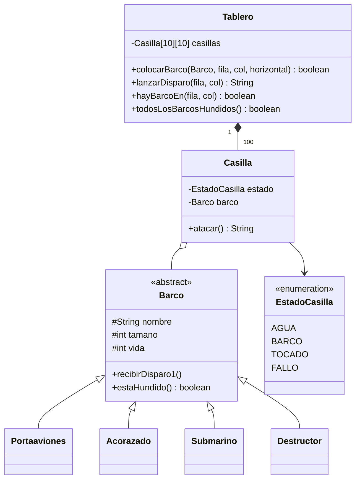

# Battleship

Implementación en Java del juego de Batalla Naval contra la computadora, con dos interfaces independientes (consola y Swing) sobre un mismo modelo de dominio y un sistema de habilidades especiales por tipo de nave.


---

## Tabla de contenidos

1. [Características](#características)
2. [Reglas y mecánicas](#reglas-y-mecánicas)
3. [Arquitectura](#arquitectura)
4. [Requisitos](#requisitos)
5. [Compilación y ejecución](#compilación-y-ejecución)
6. [Uso](#uso)
7. [Estructura del repositorio](#estructura-del-repositorio)
8. [Limitaciones y trabajo futuro](#limitaciones-y-trabajo-futuro)
9. [Autor](#autor)

---

## Características

- Tablero de **10 × 10** casillas por jugador, con coordenadas `0–9` en filas y columnas.
- Flota de cuatro naves de distinto tamaño, con colocación manual (jugador) y aleatoria (CPU).
- **Habilidades especiales** por nave: ataque aéreo, sonar y ataque de racimo, con límite de usos.
- Dos interfaces sobre el mismo modelo:
  - **Consola** (`Main`): flujo por turnos mediante `Scanner`.
  - **Swing** (`graficos.BattleshipGUI`): tableros interactivos, bitácora de eventos y diálogos de fin de partida.
- Modelo de dominio desacoplado de la presentación (`mapa`, `naves`).
- Sin dependencias externas: solo la biblioteca estándar de Java.

## Reglas y mecánicas

### Flota

| Nave | Tamaño | Habilidad especial | Usos por partida |
|------|:------:|--------------------|:----------------:|
| Portaaviones | 5 | **Ataque aéreo**: lanza 3 misiles a coordenadas aleatorias del tablero enemigo | 1 |
| Acorazado | 4 | **Ataque de racimo**: dispara sobre un área de 2 × 2 a partir de una coordenada | 1 |
| Submarino | 3 | **Sonar**: indica si hay alguna nave enemiga en un área de 2 × 2 | 2 |
| Destructor | 2 | Ninguna | — |

### Desarrollo de la partida

1. **Despliegue:** el jugador coloca sus naves (en el orden de la tabla anterior); la CPU coloca las suyas de forma aleatoria.
2. **Turnos alternados**, comenzando por el jugador. En su turno puede realizar un disparo normal o usar una habilidad. Usar una habilidad consume el turno.
3. Una habilidad **no está disponible** si la nave que la porta ya fue hundida.
4. La CPU dispara a coordenadas aleatorias sobre el tablero del jugador.
5. Gana quien hunda primero todas las naves del oponente.

### Estados de casilla

| Símbolo (consola) | Estado | Significado |
|:-----------------:|--------|-------------|
| `~` | `AGUA` | Casilla sin disparar (o nave enemiga oculta) |
| `B` | `BARCO` | Nave propia sin impactar |
| `X` | `TOCADO` | Impacto en una nave |
| `O` | `FALLO` | Disparo al agua |

## Arquitectura

El proyecto está organizado en tres paquetes con responsabilidades separadas.

| Paquete | Responsabilidad | Clases |
|---------|-----------------|--------|
| `naves` | Jerarquía de naves, vida restante y habilidades | `Barco` (abstracta), `Portaaviones`, `Acorazado`, `Submarino`, `Destructor` |
| `mapa` | Tablero, casillas y reglas de colocación y disparo | `Tablero`, `Casilla`, `EstadoCasilla` |
| `graficos` | Interfaz gráfica Swing | `BattleshipGUI` |
| *(raíz)* | Interfaz de consola y bucle de juego | `Main` |



**Decisiones de diseño**

- `Barco` define el contrato común (vida, tamaño, detección de hundimiento) y cada subclase sobrescribe `recibirDisparo1()` para emitir su propio mensaje de impacto.
- `Tablero` valida límites y solapamientos antes de colocar una nave, y expone `lanzarDisparo` con comprobación de coordenadas.
- Las casillas mantienen una referencia a la nave que las ocupa, de modo que un impacto actualiza la vida de la nave directamente.
- Las habilidades reciben el `Tablero` enemigo como parámetro, por lo que no dependen de ninguna interfaz de usuario.

## Requisitos

- **JDK 11 o superior** (compilado y verificado con OpenJDK 21).
- Un entorno gráfico para el modo Swing.

> El código fuente usa identificadores con `ñ` (por ejemplo `getTamaño`), por lo que se debe compilar con codificación **UTF-8**.

## Compilación y ejecución

### Desde la línea de comandos

**Linux / macOS**

```bash
mkdir -p bin
javac -encoding UTF-8 -d bin $(find src -name "*.java")

java -cp bin graficos.BattleshipGUI   # interfaz gráfica
java -cp bin Main                     # modo consola
```

**Windows (PowerShell)**

```powershell
New-Item -ItemType Directory -Force bin | Out-Null
javac -encoding UTF-8 -d bin (Get-ChildItem -Recurse src -Filter *.java).FullName

java -cp bin graficos.BattleshipGUI
java -cp bin Main
```

### Desde IntelliJ IDEA

1. Abrir la carpeta del proyecto (`File ▸ Open`).
2. Verificar que `src` esté marcada como *Sources Root* y que haya un JDK configurado.
3. Ejecutar `graficos.BattleshipGUI` (interfaz gráfica) o `Main` (consola).

## Uso

### Modo gráfico

1. **Colocación:** haz clic en el tablero **TU FLOTA** para ubicar cada nave; usa el botón de orientación para alternar entre horizontal y vertical.
2. **Combate:** en el tablero **ENEMIGO** haz clic sobre una casilla para disparar, o utiliza los botones de habilidad (Portaaviones, Submarino, Acorazado). El sonar y el ataque de racimo solicitan la coordenada mediante un diálogo.
3. La bitácora inferior registra cada acción y su resultado. Al terminar la partida se muestra un diálogo de victoria o derrota.

### Modo consola

- **Despliegue:** para cada nave se solicita `Fila`, `Columna` y `¿Horizontal? (true/false)`.
- **Turno:** se elige entre `1. Disparo de Cañón` (pide fila y columna, `0–9`) y `2. Habilidad Especial` (selección de nave y, según el caso, coordenada central).

## Estructura del repositorio

```text
Battleship/
├── src/
│   ├── Main.java                  # Interfaz de consola y bucle de juego
│   ├── graficos/
│   │   └── BattleshipGUI.java     # Interfaz gráfica (Swing)
│   ├── mapa/
│   │   ├── Casilla.java
│   │   ├── EstadoCasilla.java
│   │   └── Tablero.java
│   └── naves/
│       ├── Barco.java
│       ├── Portaaviones.java
│       ├── Acorazado.java
│       ├── Submarino.java
│       └── Destructor.java
├── Battleship.iml                 # Módulo de IntelliJ IDEA
└── .gitignore
```

## Limitaciones y trabajo futuro

- La CPU dispara de forma aleatoria y sin memoria, por lo que puede repetir coordenadas.
- El modo consola no valida entradas no numéricas.
- No hay pruebas automatizadas; el modelo (`mapa`, `naves`) es candidato natural para pruebas unitarias con JUnit.
- Líneas de mejora: estrategia de disparo de la CPU (búsqueda por vecindad tras un impacto), partidas guardables, soporte de tamaños de tablero configurables y empaquetado como JAR ejecutable.

## Autor

**Proximalbag3226** · [github.com/Proximalbag3226](https://github.com/Proximalbag3226)
